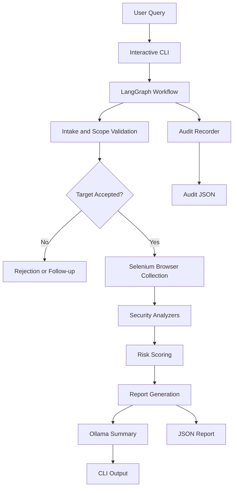

# SecureScan AI

**An AI-assisted website security analysis tool built with Python, Selenium, LangGraph, and Ollama.**

SecureScan AI combines browser-based security checks with an AI-generated assessment to help developers identify potential website security misconfigurations, understand their impact, and prioritize remediation.

The project uses a modular architecture that separates browser collection, security analyzers, workflow orchestration, report generation, and audit logging.

> **Disclaimer:** SecureScan AI is a development and security assessment tool, not a replacement for a professional penetration test. Only scan websites you own or have explicit authorization to test.

## Features

- **Browser-based analysis:** Collects browser-visible website information using Selenium and headless Chrome.
- **HTTP security headers:** Checks for missing Content-Security-Policy, clickjacking protections, X-Content-Type-Options, Referrer-Policy, and Permissions-Policy.
- **Cookie security:** Examines cookie attributes such as Secure, HttpOnly, and SameSite.
- **CSRF-related checks:** Inspects forms and token-related indicators for potential cross-site request forgery risks.
- **Script analysis:** Checks for indicators such as third-party scripts without integrity attributes, mixed content, outdated jQuery, and selected exposed-path probe matches.
- **Technology detection:** Identifies technology hints from collected page information and response headers.
- **TLS observations:** Reports available TLS-related information and selected configuration concerns.
- **Risk scoring:** Aggregates findings into a score, grade, and severity distribution.
- **AI-generated summaries:** Uses a local Ollama model to summarize the report and suggest remediation priorities.
- **LangGraph workflow:** Organizes scanning, analysis, scoring, and response generation into graph nodes.
- **JSON reports:** Saves scan results for later inspection.
- **Audit logging:** Records the original query, target URL, executed graph nodes, and available token-usage metadata.

## Architecture



### Security analyzers

| Module | Responsibility |
|---|---|
| `tools/browser.py` | Browser setup, page collection, response information, DOM inspection, and selected probes |
| `tools/headers.py` | HTTP security-header checks |
| `tools/cookies.py` | Cookie security-attribute checks |
| `tools/csrf.py` | CSRF-related form and token heuristics |
| `tools/scripts.py` | Script, mixed-content, and selected exposure checks |
| `tools/technologies.py` | Technology fingerprinting |
| `nodes/nodes.py` | Workflow nodes, scope handling, scoring, and summary generation |
| `graph.py` | LangGraph construction and routing |
| `state.py` | Shared scan state and finding aggregation |
| `audit.py` | Structured JSON audit records |
| `main.py` | Interactive CLI and workflow execution |
| `config.py` | Scanner configuration and scoring settings |

## Technology Stack

- **Language:** Python
- **Workflow orchestration:** LangGraph
- **Browser automation:** Selenium with headless Chrome
- **Local language model:** Ollama
- **Model configured by default:** `qwen3:1.7b`
- **Structured output:** JSON
- **Testing:** pytest

## Project Structure

```text
SecureScan-AI/
├── tools/
│   ├── __init__.py
│   ├── browser.py
│   ├── headers.py
│   ├── cookies.py
│   ├── csrf.py
│   ├── scripts.py
│   └── technologies.py
├── nodes/
│   ├── __init__.py
│   └── nodes.py
├── reports/
│   └── audit/
├── tests/
├── graph.py
├── main.py
├── config.py
├── state.py
├── audit.py
├── requirements.txt
├── .env.example
└── README.md
```

Generated reports are stored under `reports/`, while audit records are stored under `reports/audit/`. These directories are populated when scans run.

## Prerequisites

Before running SecureScan AI, install:

- Python 3.11 or another version supported by the project's dependencies.
- Google Chrome.
- A compatible ChromeDriver setup. Selenium Manager may handle driver management, depending on your installed Selenium version and environment.
- Ollama, with the configured model available locally.

## Installation

### 1. Clone the repository

```bash
git clone <YOUR_REPOSITORY_URL>
cd SecureScan-AI
```

Replace `<YOUR_REPOSITORY_URL>` with your repository URL.

### 2. Create a virtual environment

**Windows PowerShell**

```powershell
python -m venv .venv
.\.venv\Scripts\Activate.ps1
```

**macOS/Linux**

```bash
python3 -m venv .venv
source .venv/bin/activate
```

### 3. Install dependencies

```bash
python -m pip install --upgrade pip
pip install -r requirements.txt
```

### 4. Configure Ollama

Start Ollama and download the configured model:

```bash
ollama pull qwen3:1.7b
```

Ensure the model name matches `OLLAMA_MODEL` in `config.py`.

### 5. Review the configuration

Review `config.py` before the first scan. Confirm that scope validation, probe settings, report locations, model configuration, and scoring weights are appropriate for your environment.

Do not commit credentials, private configuration, or sensitive scan reports to a public repository.

## Usage

Start the interactive CLI:

```bash
python main.py
```

Example session:

```text
SecureScan AI ready. Submit a URL, ask a follow-up, or type 'bye' to exit.
Only scan websites you own or are authorized to test.

You: analyze the https://example.com

  [Running] intake
  [Running] scope_check
  [Running] load_page
  [Complete] analyze_cookies
  [Complete] analyze_csrf
  [Complete] analyze_headers
  [Complete] analyze_scripts
  [Complete] detect_tech

WEBSITE SECURITY REPORT
...

SecureScan AI:
...

Audit saved: reports/audit/scan_....json

You: bye
```

The example illustrates the expected interaction; actual findings, scores, and workflow output depend on the target and the current implementation.

You can also ask follow-up questions within the interactive session, subject to the conversation memory and routing implemented by the workflow.

## Understanding the Report

A report can include the following categories:

| Category | Meaning |
|---|---|
| High | A potentially significant security issue that should be investigated promptly |
| Medium | A security weakness that may increase risk depending on the application's behavior |
| Low | A lower-severity hardening opportunity |
| Info | An observation that may be useful for understanding the target |

The report may also contain HTTP status, HTTPS/TLS observations, response time, technology hints, and a prioritized summary.

**Interpretation matters:** a missing header or suspicious form configuration is evidence of a potential weakness, not automatically proof of an exploitable vulnerability. Validate findings before treating them as confirmed issues.

## Reports and Audit Logs

### Scan reports

Generated JSON reports are saved in `reports/`. They contain structured scan findings and other collected information, depending on the current report implementation.

### Audit records

Audit JSON files are saved in `reports/audit/`.

Audit records are designed to capture:

- Audit ID and timestamp.
- Original user query.
- Target URL.
- Executed workflow nodes.
- Input, output, and total token counts when available.
- Token-usage provenance.
- Overall token usage and whether it is complete.

Token counts are not necessarily available for every model invocation. SecureScan AI should preserve unknown values as `null` rather than inventing usage figures. Non-LLM operations do not consume LLM tokens.

Audit records currently track graph-node executions; they should not be interpreted as a complete trace of every internal browser operation.

## Running Tests

Run the test suite from the project root:

```bash
python -m pytest -v
```

The suite includes tests for foundational configuration, browser collection behavior, security analyzers, workflow nodes, graph construction, and CLI/audit integration.

A passing test suite validates the tested behaviors, but does not prove that every real-world vulnerability can be detected.

## Current Limitations

- **Frontend visibility:** The current scanner primarily examines information exposed by the public website and browser.
- **Backend source code:** A URL-only scan cannot inspect private backend source code.
- **API coverage:** Discovering an API host does not automatically test every endpoint, authentication flow, authorization rule, or business-logic vulnerability.
- **Heuristic checks:** Some checks rely on HTML, headers, or naming patterns and may produce false positives or miss issues.
- **Dynamic applications:** JavaScript-heavy applications, authenticated pages, and content loaded after initial navigation may require additional instrumentation.
- **Active vulnerability testing:** The current workflow should not be represented as comprehensive SQL injection, cross-site scripting exploitation, or penetration testing.
- **Token accounting:** Usage metadata depends on what the configured model integration exposes.
- **Scoring:** The score is a prioritization aid based on implemented rules, not a formal security certification or a calibrated probability of compromise.

## Roadmap

Potential future extensions include:

- API endpoint discovery and authorized API security analysis.
- Authentication-aware scanning using explicitly supplied test credentials.
- Backend repository scanning and static application security testing.
- Dependency vulnerability analysis.
- Better coverage of authenticated and JavaScript-driven applications.
- Evidence-linked findings and confidence ratings.
- More comprehensive audit traces and reproducible reports.
- Configurable scan profiles and export formats.

These are roadmap items unless they have been implemented and tested in the current codebase.

## Responsible Use

SecureScan AI is intended for authorized defensive security testing and education.

- Scan only websites you own or have explicit permission to assess.
- Do not attempt to bypass access controls or access data belonging to other users.
- Use non-destructive checks unless a stronger test has been explicitly authorized.
- Protect reports and audit logs because they may contain sensitive technical details.
- Obtain authorization before running active probes or testing production systems.

The maintainers assume no responsibility for unauthorized use or damage caused by misuse of this software.

## Contributing

Contributions that improve detection accuracy, test coverage, evidence quality, and safe scanning behavior are welcome.

1. Fork the repository.
2. Create a feature branch.
3. Implement the change with appropriate tests.
4. Run `python -m pytest -v`.
5. Submit a pull request explaining the change and its security implications.

## License

Add a license before distributing the project publicly. Until a license is included, reuse and redistribution are subject to applicable copyright law.

---

**SecureScan AI — Discover potential security weaknesses, understand the evidence, and prioritize fixes.**
